<div align="center">

# Tiny-Drone

**语言 / Language**

<table>
<tr>
<td align="center" width="50%"><b>简体中文 ✓</b></td>
<td align="center" width="50%"><a href="README_EN.md"><b>English →</b></a></td>
</tr>
</table>

<br>

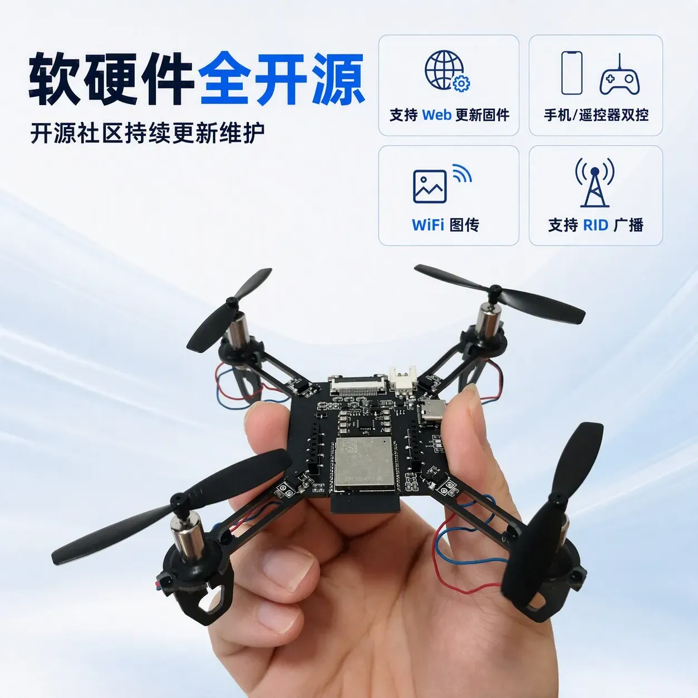

</div>

---

## ✨ Tiny-Drone 能做什么

<table>
<tr>
<td width="25%" align="center"><b>📷 Wi-Fi 图传</b><br><sub>实时视频传输<br>边飞边看</sub></td>
<td width="25%" align="center"><b>🎮 多种控制</b><br><sub>Android App · Web 浏览器<br>实体遥控器（ESP32-C3）</sub></td>
<td width="25%" align="center"><b>📡 RID 广播</b><br><sub>支持 RID 广播<br>实名登记与激活</sub></td>
<td width="25%" align="center"><b>🔧 开放硬件</b><br><sub>原理图 / PCB 开放<br>支持二次开发</sub></td>
</tr>
</table>

Tiny-Drone（探秘者）是一款基于 **ESP32-S3** 开发的开源微型无人机。项目主要代码源自 Espressif [ESP-Drone](https://github.com/espressif/esp-drone)，并在此基础上加入 Wi-Fi 图传、浏览器控制、RID 广播及扩展传感器等功能。

软件遵循 [GPL-3.0 License](LICENSE)，[硬件工程已开源](https://oshwhub.com/xiaochen_study/project_wsijdhkn)。

---

## 🎬 看它飞起来

<div align="center">
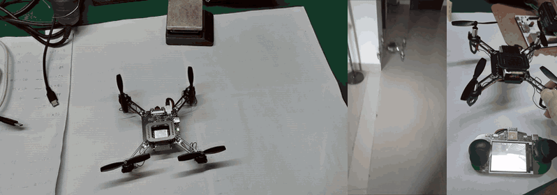
</div>

### 视频教程
[**▶ 室内飞行演示**](https://www.bilibili.com/video/BV1T7th6gEEx/)

[**▶ 从零组装 Tiny-Drone**](https://www.bilibili.com/video/BV1CBtU6UEvK/)

---

## 🎮 三种控制方式

Tiny-Drone 支持 **Android App、Web 浏览器和 ESP32-C3 实体遥控器** 三种控制方式。上电后连接无人机自建 Wi-Fi，即可开始控制：

```text
Wi-Fi    TINY-DRONE_XXXXXXXXXXXX
密码    87654321
网页    192.168.26.28
```

<table>
<tr>
<td width="50%" align="center">
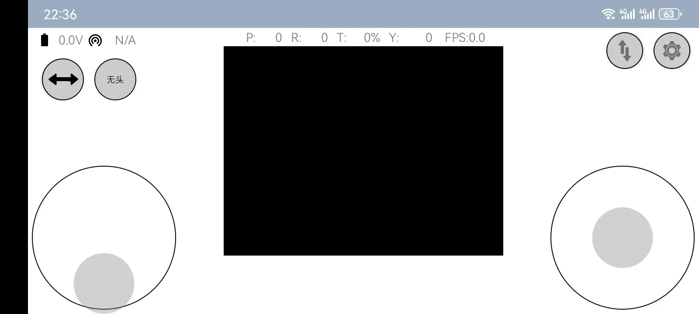<br><br>
<b>Android App</b><br>
<sub>完整操控界面 · 实时图传 · 参数设置</sub><br><br>
</td>
<td width="50%" align="center">
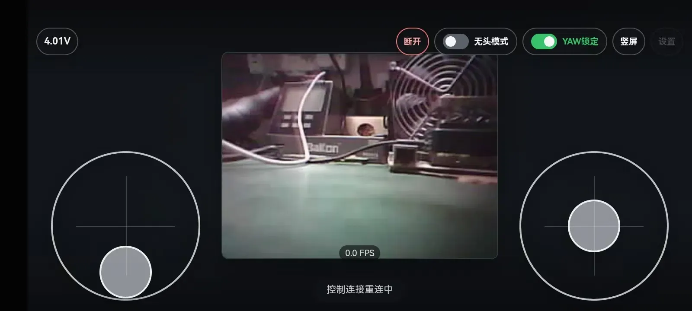<br><br>
<b>手机浏览器</b><br>
<sub>无需安装 · 连接 Wi-Fi 后直接访问</sub><br><br>
<code>192.168.26.28</code>
</td>
</tr>
</table>

### 实体遥控器

除了 Android App 和手机浏览器，Tiny-Drone 还支持配套的 **Tiny-Drone 开源实体遥控器**。遥控器基于 **ESP32-C3**，配备双摇杆和彩色屏幕，可以直接连接无人机热点进行操控，并在屏幕上查看兼容的 Wi-Fi 图传和飞行状态。

<table>
<tr>
<td width="42%" align="center" valign="middle">
<b>🎮 Tiny-Drone 实体遥控器</b><br><br>
<sub>ESP32-C3 · 双摇杆 · 320×240 横屏显示 · Wi-Fi 图传</sub><br><br>
<a href="https://github.com/jonny-lekaiwu/Tiny-Drone-Controller"><b>查看遥控器开源项目 →</b></a><br><br>
<a href="https://oshwhub.com/xiaochen_study/project_nchmaogv"><b>复刻实体遥控器 →</b></a>
</td>
<td width="58%" align="center" valign="middle">
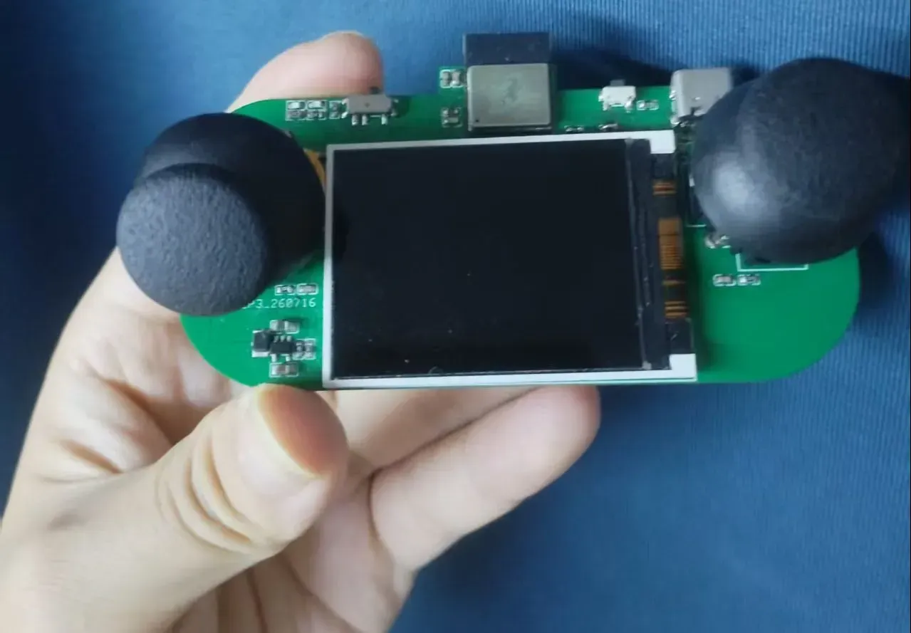
</td>
</tr>
</table>

<details>
<summary><b>📱 扫码下载 Android App</b></summary>
<br>

</details>

> iPhone 当前可直接使用浏览器控制。iOS App 正在规划中，将根据实际需求安排开发。

---

## 🔬 Tiny-Drone 内部硬件

<table>
<tr>
<td width="33%" valign="top"><b>⚡ 电源系统</b><br><sub>锂电池升压 + LDO，为主控、传感器和摄像头提供稳定电源。</sub></td>
<td width="33%" valign="top"><b>🧠 ESP32-S3</b><br><sub>负责飞控、无线通信、图传及外设控制。</sub></td>
<td width="33%" valign="top"><b>🧭 ZY-MPU6050</b><br><sub>六轴姿态传感器，模块化设计便于手工焊接。</sub></td>
</tr>
<tr>
<td valign="top"><b>⚙️ 电机驱动</b><br><sub>驱动四路空心杯电机，完成姿态与升力控制。</sub></td>
<td valign="top"><b>📷 摄像头</b><br><sub>摄像头提供 Wi-Fi 实时图传。</sub></td>
<td valign="top"><b>🧩 扩展接口</b><br><sub>支持气压计、VL53L1X 测距及定点悬停模块。</sub></td>
</tr>
</table>

<details open>
<summary><b>ESP32-S3 主控及 ADC 电量采集</b></summary>
<br><div align="center">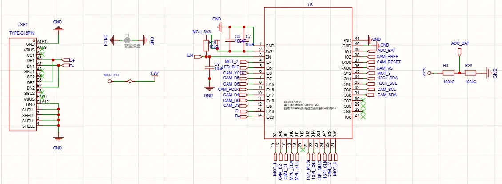</div>
</details>

<details>
<summary><b>电源系统</b></summary>
<br><div align="center">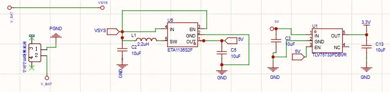</div>
</details>

<details>
<summary><b>状态指示灯 / 传感器 / 电机驱动</b></summary>
<br>
<div align="center">
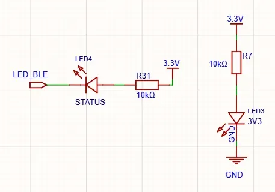<br><br>
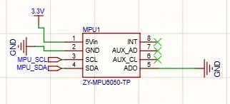<br><br>
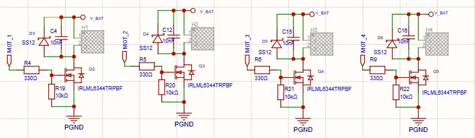
</div>
</details>

<details>
<summary><b>摄像头与扩展模块</b></summary>
<br>
<div align="center">
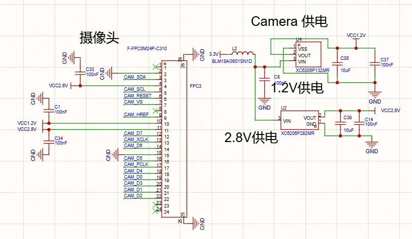<br><br>
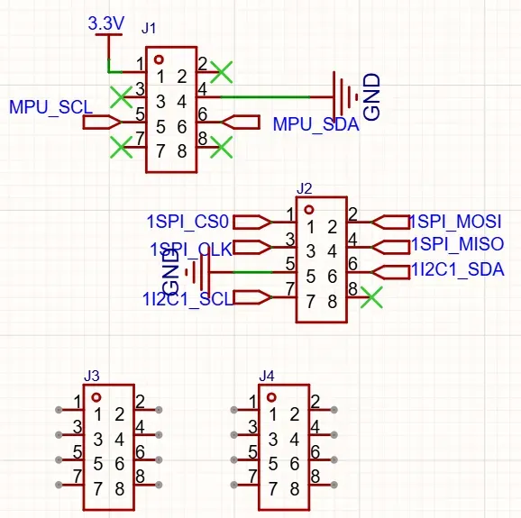
</div>
</details>

---

## 📸 实物展示

<table>
<tr>
<td width="50%">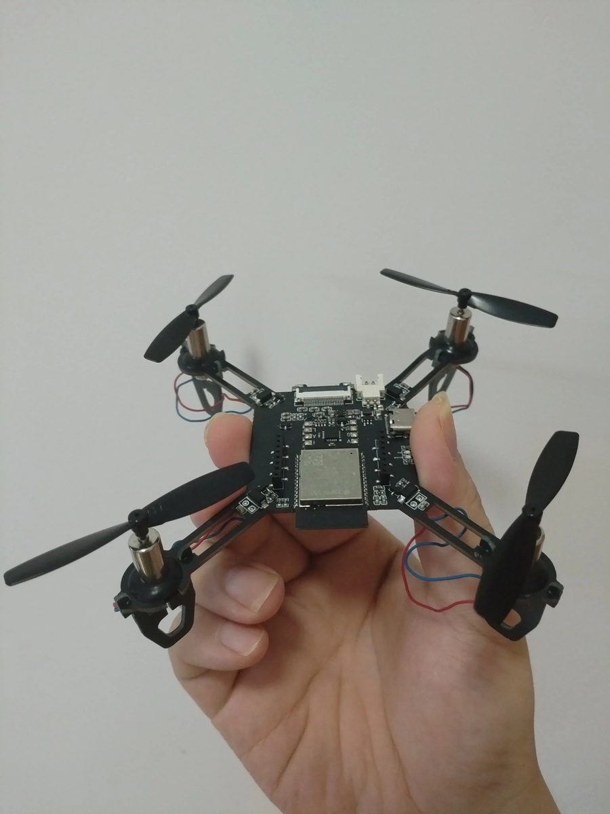</td>
<td width="50%">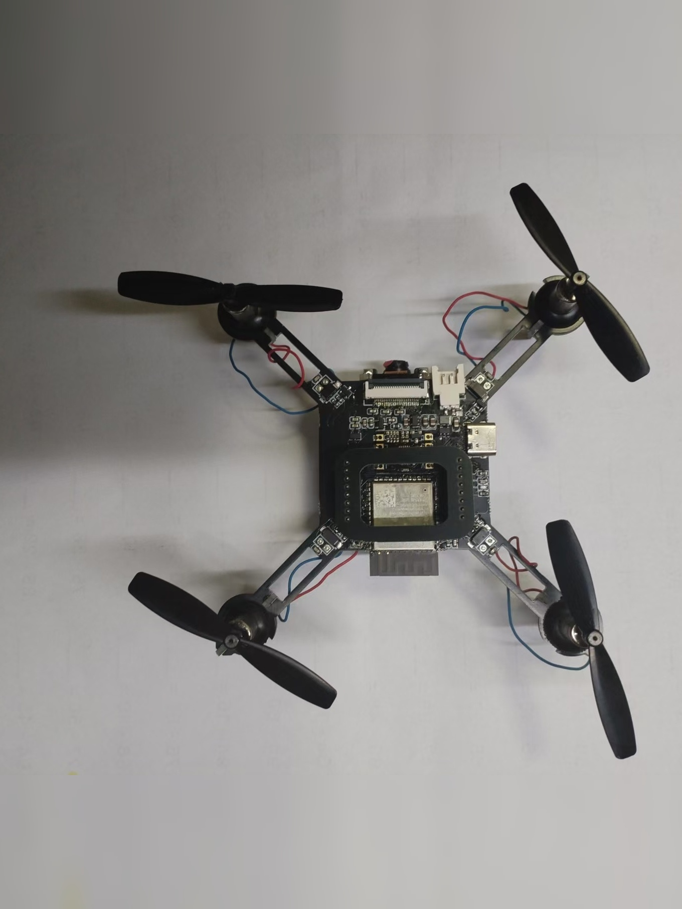</td>
</tr>
<tr>
<td>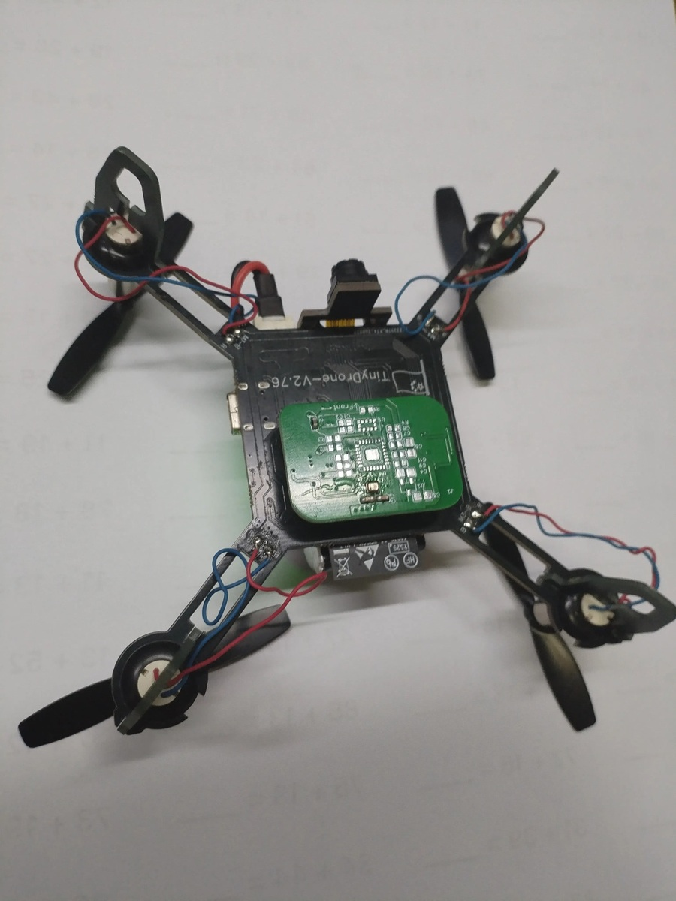</td>
<td>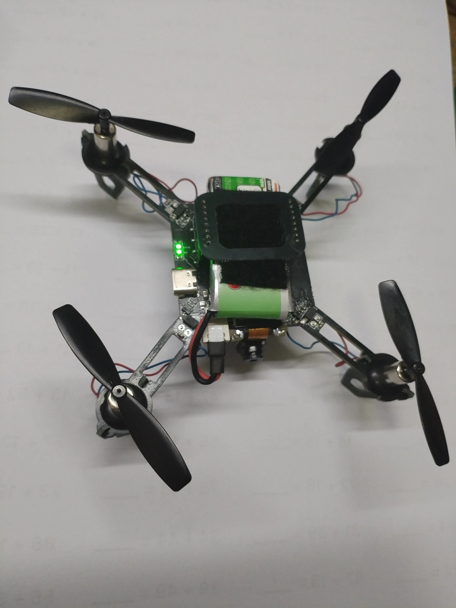</td>
</tr>
</table>

---

## 🛠️ 复刻 Tiny-Drone

<table>
<tr>
<td align="center" width="20%"><b>01</b><br><b>准备元器件</b><br><sub>BOM / 物料包</sub></td>
<td align="center" width="20%"><b>02</b><br><b>PCB 打板</b><br><sub>推荐 1.6 mm</sub></td>
<td align="center" width="20%"><b>03</b><br><b>焊接组装</b><br><sub>锡膏 / 加热台</sub></td>
<td align="center" width="20%"><b>04</b><br><b>在线烧录</b><br><sub>选择版本 · USB 连接</sub></td>
<td align="center" width="20%"><b>05</b><br><b>调整试飞</b><br><sub>电机 / 桨叶</sub></td>
</tr>
</table>

### 01 · 准备元器件

按照 BOM 清单购买元器件，也可以直接购买[物料包](https://item.taobao.com/item.htm?ft=t&id=1080586148318)。ZY-MPU6050 和 OV2640 建议选择经过测试的产品。

<div align="center">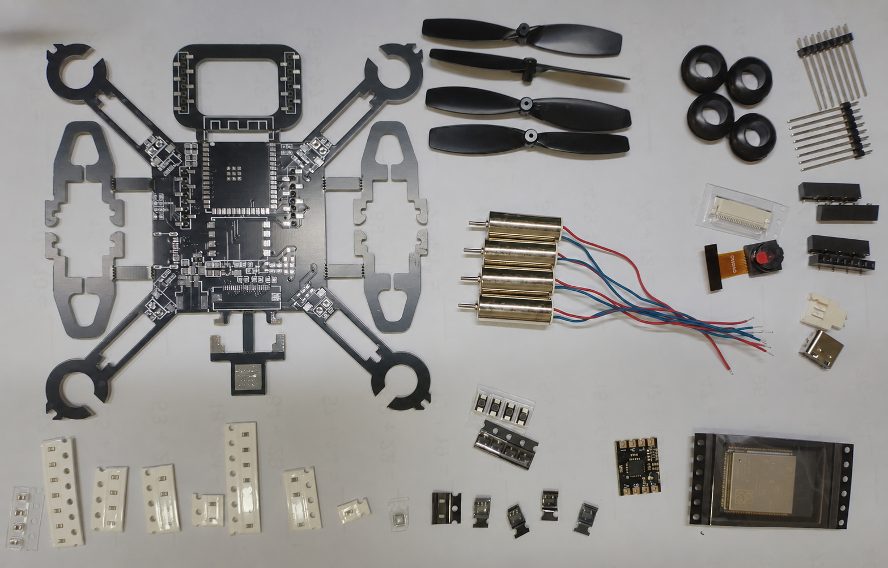</div>

### 02 · PCB 打板与硬件组装

在嘉立创打开硬件工程并导出 PCB 下单。**PCB 厚度请选择 1.6 mm**，否则胶圈与 PCB 之间可能产生间隙，影响电机固定。

<table>
<tr>
<td width="55%" align="center">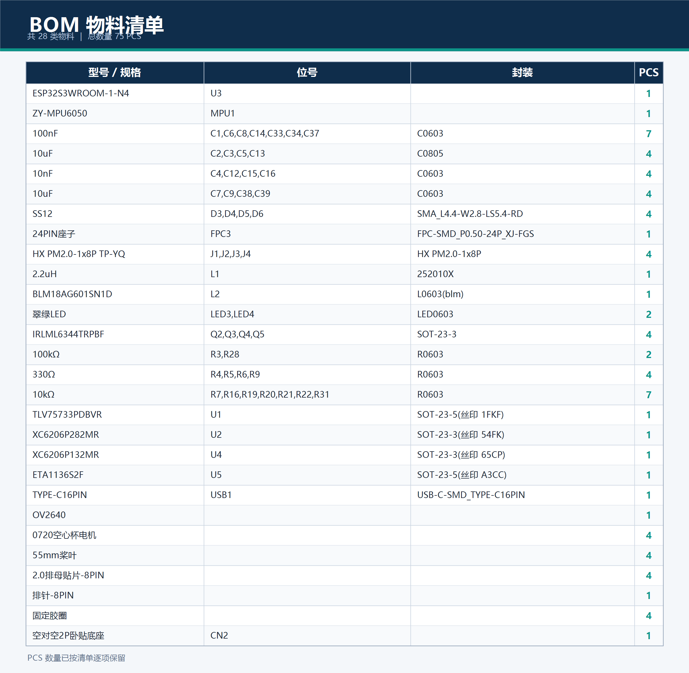<br><sub>硬件组装</sub></td>
<td width="45%" align="center">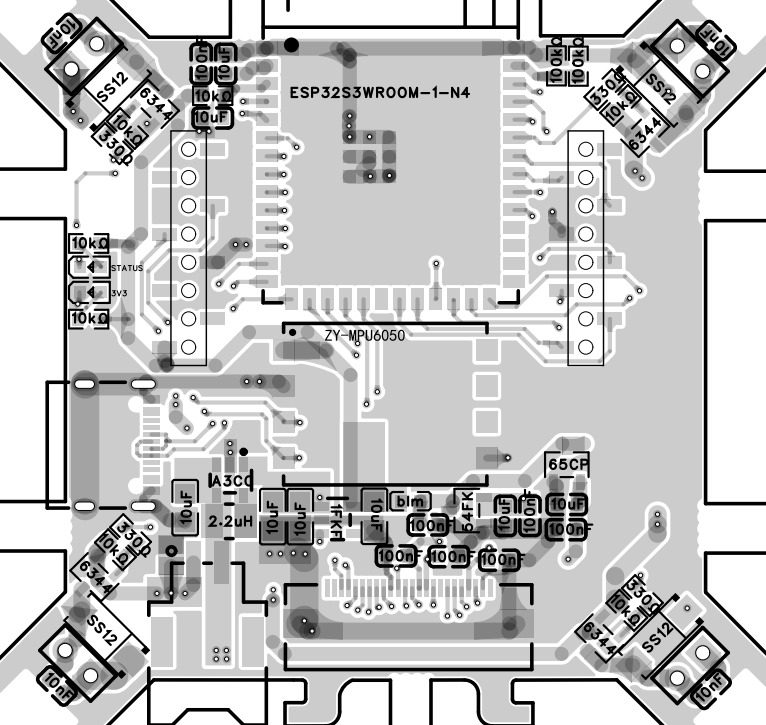<br><sub>SMT 贴片图</sub></td>
</tr>
</table>

### 03 · 焊接

- 使用 ZY-MPU6050 模块，降低陀螺仪手工焊接难度。
- FPC 座建议使用刀型 USB 电烙铁；连锡时可配合助焊剂拖锡。
- TYPE-C 16Pin 接口可使用中温锡膏配合小体积刀型电烙铁焊接。

### 04 · 在线烧录

无需自行下载固件，也无需填写烧录地址。使用乐开物在线烧录工具即可完成固件选择、设备连接和自动烧录。

1. 使用电脑端 **Chrome 或 Edge** 打开 [Tiny-Drone 在线烧录工具](https://www.lekaiwu.cn/tools/firmware/)。
2. 选择 **Tiny-Drone**，根据需要选择「标准版（RID）」或「无 RID 版」。
3. 使用 USB 数据线连接无人机，点击 **选择 COM 口 / 连接并烧录**。
4. 首次使用时授权串口访问，之后按页面提示完成自动烧录。
5. 烧录完成后重新启动 Tiny-Drone。

> **注意：** 烧录前请关闭正在占用串口的串口助手、ESP-IDF Monitor 等工具。

<details>
<summary><b>开发者：自行编译与命令行烧录</b></summary>
<br>
项目基于 <b>ESP-IDF v5.5.3</b> 编译。Windows 环境可从 <a href="https://dl.espressif.cn/dl/esp-idf/?idf=5.5.3">Espressif 下载 ESP-IDF</a>。

```bash
./build.bat tiny-drone
idf.py flash monitor -p COMX
```

</details>

### 05 · 调整并试飞

<table>
<tr>
<td width="33%" align="center">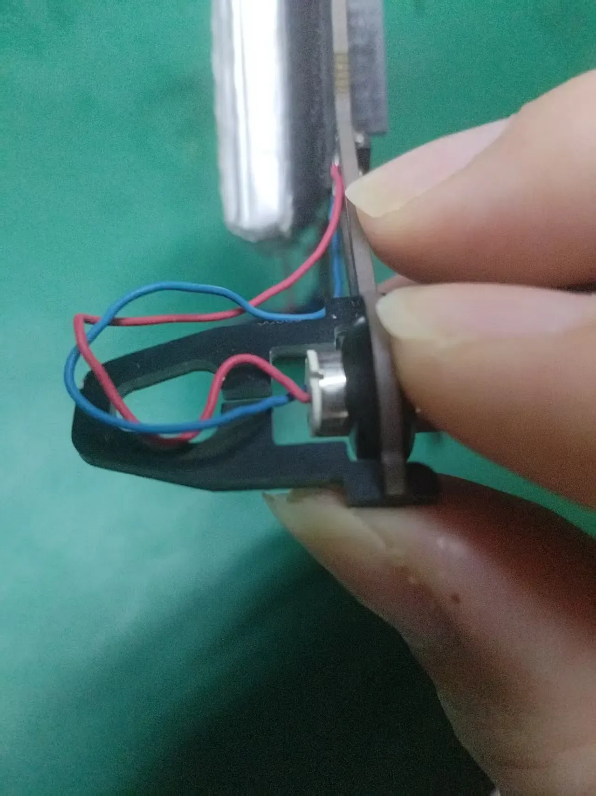<br><b>电机位置</b><br><sub>与底座保留适当间隙</sub></td>
<td width="33%" align="center">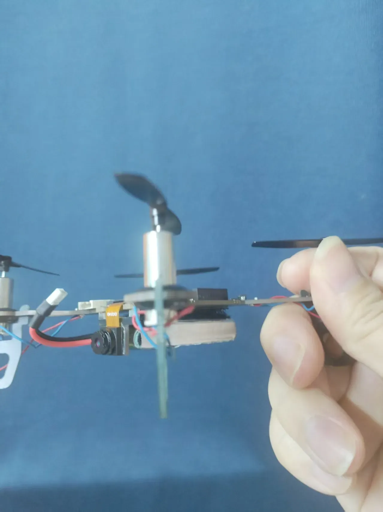<br><b>电机角度</b><br><sub>尽量与水平面垂直</sub></td>
<td width="33%" align="center">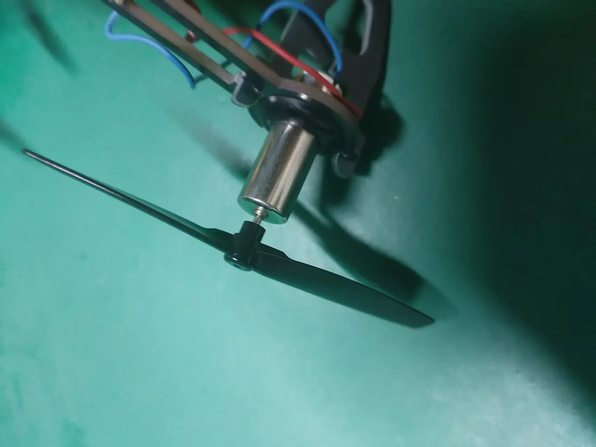<br><b>桨叶深度</b><br><sub>建议保留约 2 mm 间距</sub></td>
</tr>
</table>

---

## ⚠️ 飞行前请注意

- Wi-Fi 图传在电机干扰或电池电压较低时，可能出现横纹或画面异常。
- 出现航向角偏移时，应检查电机高度、桨叶方向及安装深度。
- 使用定高等功能前，请先确认基础飞行状态正常，并完成相关传感器检查。
- 安装桨叶时力度要轻，可用手抵住电机底部，避免用力过大导致空心杯电机底座或后盖脱落。

<details open>
<summary><b>飞行安全与实名登记</b></summary>
<br>
建议优先在室内安全环境中试飞。需要室外飞行时，请先确认已经申请产品序列号、完成实名登记，并通过设备激活工具开启 RID 广播功能，同时遵守所在地的无人机飞行规定。

- 在线烧录时选择「标准版（RID）」：<a href="https://www.lekaiwu.cn/tools/firmware/">Tiny-Drone 在线烧录</a>
- 完成实名登记后进行设备激活：<a href="https://www.lekaiwu.cn/tools/device-activation/">设备激活工具</a>

</details>

---

## ❓ 故障排除

<details>
<summary><b>打开电源后，拉油门没有反应</b></summary>
<br>观察状态指示灯是否处于慢闪状态。可能是 MPU6050 未通过自检，请同时确认无人机是否保持水平。
</details>

<details>
<summary><b>撞到物体后，再次拉油门没有反应</b></summary>
<br>无人机可能检测到跌落并进入急停状态，请重启设备。
</details>

<details>
<summary><b>摄像头没有反应</b></summary>
<br>检查日志确认摄像头是否初始化成功。若初始化成功，请检查信号线焊接，以及是否与 GND、3.3 V 或其他信号线短路。
</details>

<details>
<summary><b>起飞后，航向角总是偏向一侧</b></summary>
<br>检查四个电机的安装高度与角度。如果无人机持续向右偏，可尝试将左侧电机稍微调低，或将右侧电机适当调高。
</details>

<details>
<summary><b>其中一个桨叶不转</b></summary>
<br>电机可能因碰撞损坏或内部接线断开，需要更换电机。如果更换后仍有问题，请检查 MCU 到电机驱动部分的相关焊点。
</details>

<details open>
<summary><b>桨叶转动，但无人机无法起飞</b></summary>
<br>检查桨叶型号、方向和安装位置是否正确。
<br><br><div align="center">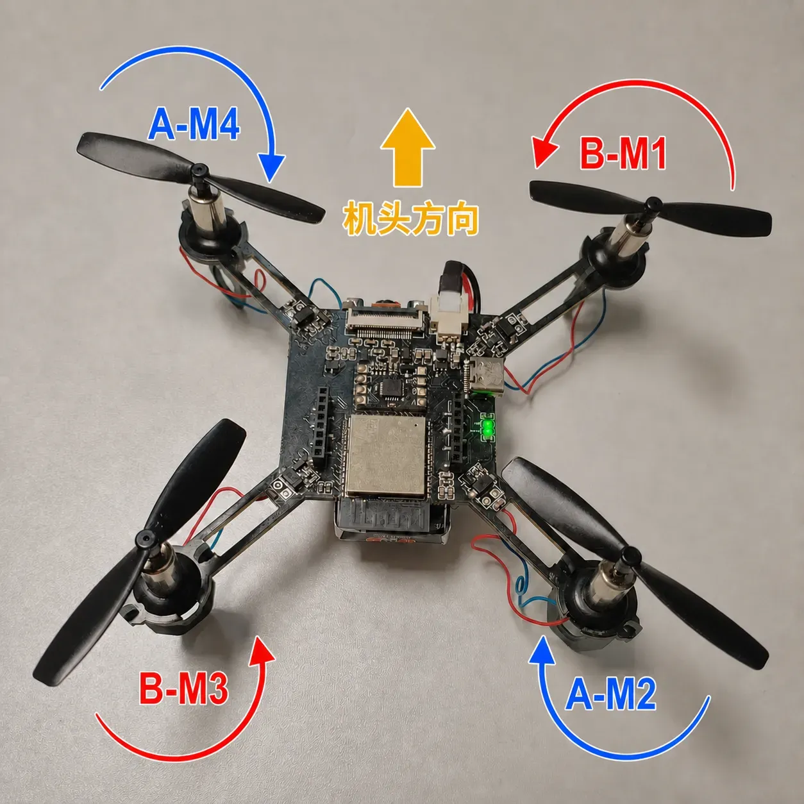</div>
</details>

---

## 🔗 相关项目与资源

- [**Tiny-Drone 源代码 →**](https://github.com/jonny-lekaiwu/Tiny-Drone) — 无人机固件与项目源码
- [**Android App →**](https://github.com/jonny-lekaiwu/ESP-Drone-Android) — Android 控制端源码
- [**Tiny-Drone 实体遥控器 →**](https://github.com/jonny-lekaiwu/Tiny-Drone-Controller) — ESP32-C3 双摇杆带屏遥控器源码
- [**复刻实体遥控器 →**](https://oshwhub.com/xiaochen_study/project_nchmaogv) — 遥控器原理图、PCB 与硬件工程
- [**Tiny-Drone 硬件工程 →**](https://oshwhub.com/xiaochen_study/project_wsijdhkn) — 原理图、PCB、技术分享与项目讨论
- [**Tiny-Drone 完整文档 →**](https://www.lekaiwu.cn/tiny-drone/) — 复刻步骤、硬件说明、视频与使用文档
- [**在线烧录工具 →**](https://www.lekaiwu.cn/tools/firmware/) — 选择固件版本后通过 USB 自动烧录
- [**设备激活工具 →**](https://www.lekaiwu.cn/tools/device-activation/) — 实名登记后激活设备与 RID 相关功能

---
