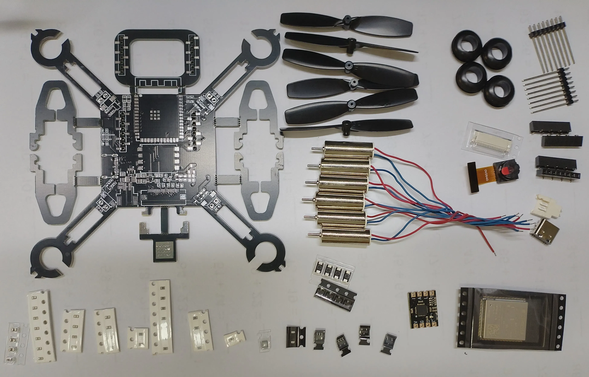

<div align="center">

# Tiny-Drone

**Language**

<table>
<tr>
<td align="center" width="50%"><a href="README.md"><b>简体中文 →</b></a></td>
<td align="center" width="50%"><b>English ✓</b></td>
</tr>
</table>

<br>


</div>

---

## ✨ What Tiny-Drone Can Do

<table>
<tr>
<td width="25%" align="center"><b>📷 Wi-Fi Video</b><br><sub>Live video streaming<br>while you fly</sub></td>
<td width="25%" align="center"><b>🎮 Multiple Controls</b><br><sub>Android App · Web Browser<br>Physical Controller (ESP32-C3)</sub></td>
<td width="25%" align="center"><b>📡 RID Broadcast</b><br><sub>RID broadcast support<br>Registration & activation</sub></td>
<td width="25%" align="center"><b>🔧 Open Hardware</b><br><sub>Open schematic / PCB<br>Ready for further development</sub></td>
</tr>
</table>

Tiny-Drone is an open-source micro drone built around the **ESP32-S3**. It is based primarily on Espressif's [ESP-Drone](https://github.com/espressif/esp-drone), with additional features including Wi-Fi video streaming, browser-based control, RID broadcasting, and support for expansion sensors.

The software is released under the [GPL-3.0 License](LICENSE), and the [hardware design is open source](https://oshwhub.com/xiaochen_study/project_wsijdhkn).

---

## 🎬 See It Fly

<div align="center">

</div>

### Videos

[**▶ Indoor Flight Demo**](https://www.bilibili.com/video/BV1T7th6gEEx/)

[**▶ Build Tiny-Drone from Scratch**](https://www.bilibili.com/video/BV1CBtU6UEvK/)

---

## 🎮 Three Ways to Control Tiny-Drone

Tiny-Drone can be controlled with the **Android App, a web browser, or the ESP32-C3 physical controller**. After powering on the drone, connect to its Wi-Fi network to get started:

```text
Wi-Fi       TINY-DRONE_XXXXXXXXXXXX
Password    87654321
Web UI      192.168.26.28
```

<table>
<tr>
<td width="50%" align="center">
<br><br>
<b>Android App</b><br>
<sub>Full control interface · Live video · Parameter settings</sub><br><br>
</td>
<td width="50%" align="center">
<br><br>
<b>Web Browser</b><br>
<sub>No installation required · Connect to Wi-Fi and open the address</sub><br><br>
<code>192.168.26.28</code>
</td>
</tr>
</table>

### Physical Controller

In addition to the Android App and web browser, Tiny-Drone supports a dedicated **open-source physical controller**. The controller is built around an **ESP32-C3**, with dual joysticks and a color display. It connects directly to the drone's Wi-Fi network for flight control and can display compatible Wi-Fi video and flight status information.

<table>
<tr>
<td width="42%" align="center" valign="middle">
<b>🎮 Tiny-Drone Physical Controller</b><br><br>
<sub>ESP32-C3 · Dual joysticks · 320×240 landscape display · Wi-Fi video</sub><br><br>
<a href="https://github.com/jonny-lekaiwu/Tiny-Drone-Controller"><b>View Controller Project →</b></a><br><br>
<a href="https://oshwhub.com/xiaochen_study/project_nchmaogv"><b>Build the Controller →</b></a>
</td>
<td width="58%" align="center" valign="middle">

</td>
</tr>
</table>

<details>
<summary><b>📱 Scan to Download the Android App</b></summary>
<br>

</details>

> iPhone users can currently control Tiny-Drone directly from a web browser. A native iOS app is planned and will be developed based on actual demand.

---

## 🔬 Inside Tiny-Drone

<table>
<tr>
<td width="33%" valign="top"><b>⚡ Power System</b><br><sub>Li-ion boost converter + LDOs provide stable power for the MCU, sensors, and camera.</sub></td>
<td width="33%" valign="top"><b>🧠 ESP32-S3</b><br><sub>Handles flight control, wireless communication, video streaming, and peripherals.</sub></td>
<td width="33%" valign="top"><b>🧭 ZY-MPU6050</b><br><sub>6-axis motion sensor in a module format that is easier to hand-solder.</sub></td>
</tr>
<tr>
<td valign="top"><b>⚙️ Motor Drivers</b><br><sub>Drive four coreless motors for attitude and thrust control.</sub></td>
<td valign="top"><b>📷 Camera</b><br><sub>Provides real-time video over Wi-Fi.</sub></td>
<td valign="top"><b>🧩 Expansion Interface</b><br><sub>Supports a barometer, VL53L1X ranging sensor, and position-hold modules.</sub></td>
</tr>
</table>

<details open>
<summary><b>ESP32-S3 MCU and ADC Battery Measurement</b></summary>
<br><div align="center"></div>
</details>

<details>
<summary><b>Power System</b></summary>
<br><div align="center"></div>
</details>

<details>
<summary><b>Status LEDs / Sensors / Motor Drivers</b></summary>
<br>
<div align="center">
<br><br>
<br><br>

</div>
</details>

<details>
<summary><b>Camera and Expansion Modules</b></summary>
<br>
<div align="center">
<br><br>

</div>
</details>

---

## 📸 Tiny-Drone Gallery

<table>
<tr>
<td width="50%"></td>
<td width="50%"></td>
</tr>
<tr>
<td></td>
<td></td>
</tr>
</table>

---

## 🛠️ Build Your Own Tiny-Drone

<table>
<tr>
<td align="center" width="20%"><b>01</b><br><b>Prepare Parts</b><br><sub>BOM / Parts kit</sub></td>
<td align="center" width="20%"><b>02</b><br><b>Order the PCB</b><br><sub>1.6 mm recommended</sub></td>
<td align="center" width="20%"><b>03</b><br><b>Solder & Assemble</b><br><sub>Solder paste / hot plate</sub></td>
<td align="center" width="20%"><b>04</b><br><b>Flash Online</b><br><sub>Select version · Connect USB</sub></td>
<td align="center" width="20%"><b>05</b><br><b>Adjust & Fly</b><br><sub>Motors / Propellers</sub></td>
</tr>
</table>

### 01 · Prepare the Components

Purchase the components according to the BOM. A [parts kit](https://item.taobao.com/item.htm?ft=t&id=1080586148318) is also available. Tested ZY-MPU6050 and OV2640 modules are recommended.

<div align="center"></div>

### 02 · Order the PCB and Assemble the Hardware

Open the hardware project on OSHWHub/JLCEDA and export the PCB for manufacturing. **Use a 1.6 mm PCB thickness**; otherwise, a gap may remain between the rubber motor mount and PCB, reducing motor retention.

<table>
<tr>
<td width="55%" align="center"><br><sub>Hardware assembly</sub></td>
<td width="45%" align="center"><br><sub>SMT placement</sub></td>
</tr>
</table>

### 03 · Soldering

- Use the ZY-MPU6050 module to reduce the difficulty of hand-soldering the IMU.
- A knife-tip USB soldering iron is recommended for the FPC connector. If solder bridges occur, apply flux and drag-solder the pins.
- The 16-pin USB Type-C connector can be soldered with medium-temperature solder paste and a small knife-tip iron.

### 04 · Flash Firmware Online

There is no need to download firmware files manually or enter flash addresses. The Lekaiwu online flashing tool handles firmware selection, device connection, and flashing in one place.

1. Open the [Tiny-Drone Online Flasher](https://www.lekaiwu.cn/tools/firmware/) in desktop **Chrome or Edge**.
2. Select **Tiny-Drone**, then choose either the **Standard (RID)** or **No-RID** firmware as needed.
3. Connect the drone with a USB data cable, then click **Select COM Port / Connect and Flash**.
4. Grant serial-port permission the first time, then follow the on-screen instructions to complete flashing automatically.
5. Restart Tiny-Drone after flashing is complete.

> **Note:** Before flashing, close any serial terminal, ESP-IDF Monitor, or other program that is using the same serial port.

<details>
<summary><b>For Developers: Build and Flash from the Command Line</b></summary>
<br>
The project is built with <b>ESP-IDF v5.5.3</b>. On Windows, download ESP-IDF from <a href="https://dl.espressif.cn/dl/esp-idf/?idf=5.5.3">Espressif</a>.

```bash
./build.bat tiny-drone
idf.py flash monitor -p COMX
```

</details>

### 05 · Adjust and Test-Fly

<table>
<tr>
<td width="33%" align="center"><br><b>Motor Position</b><br><sub>Leave suitable clearance from the base</sub></td>
<td width="33%" align="center"><br><b>Motor Angle</b><br><sub>Keep the motor axis as vertical as possible</sub></td>
<td width="33%" align="center"><br><b>Propeller Depth</b><br><sub>About 2 mm clearance is recommended</sub></td>
</tr>
</table>

---

## ⚠️ Before You Fly

- Motor interference or a low battery voltage may cause horizontal lines or other artifacts in the Wi-Fi video feed.
- If the drone consistently yaws to one side, check motor height, propeller orientation, and installation depth.
- Before using altitude-hold or other assisted functions, make sure basic flight is stable and the related sensors have been checked.
- Install propellers gently. Supporting the bottom of the motor while pressing the propeller on can help prevent the coreless motor base or rear cap from being pulled loose.

<details open>
<summary><b>Flight Safety and Registration</b></summary>
<br>
Indoor testing in a safe environment is recommended first. Before flying outdoors, make sure any required product serial number application and real-name registration have been completed, activate RID broadcasting with the device activation tool where applicable, and comply with local drone regulations.

- Select **Standard (RID)** when flashing: <a href="https://www.lekaiwu.cn/tools/firmware/">Tiny-Drone Online Flasher</a>
- After registration, activate the device here: <a href="https://www.lekaiwu.cn/tools/device-activation/">Device Activation Tool</a>

</details>

---

## ❓ Troubleshooting

<details>
<summary><b>The motors do not respond when I raise the throttle after power-on</b></summary>
<br>Check whether the status LED is blinking slowly. The MPU6050 may have failed its self-test; also make sure the drone is resting level.
</details>

<details>
<summary><b>The throttle does not respond after the drone hits an object</b></summary>
<br>The drone may have detected a fall and entered emergency-stop mode. Restart the device.
</details>

<details>
<summary><b>The camera does not work</b></summary>
<br>Check the logs to confirm that the camera initialized successfully. If initialization succeeds, inspect the signal-line solder joints and make sure they are not shorted to GND, 3.3 V, or another signal.
</details>

<details>
<summary><b>The drone always yaws to one side after takeoff</b></summary>
<br>Check the installation height and angle of all four motors. If the drone consistently yaws to the right, try lowering the motors on the left slightly or raising the motors on the right as appropriate.
</details>

<details>
<summary><b>One propeller does not spin</b></summary>
<br>The motor may have been damaged in a collision or have a broken internal connection. Replace the motor. If the problem remains, inspect the solder joints between the MCU and the corresponding motor-driver circuit.
</details>

<details open>
<summary><b>The propellers spin, but the drone cannot take off</b></summary>
<br>Check that the propeller type, rotation direction, and installation position are correct.
<br><br><div align="center"></div>
</details>

---

## 🔗 Projects & Resources

- [**Tiny-Drone Source Code →**](https://github.com/jonny-lekaiwu/Tiny-Drone) — Drone firmware and project source
- [**Android App →**](https://github.com/jonny-lekaiwu/ESP-Drone-Android) — Android controller source code
- [**Tiny-Drone Physical Controller →**](https://github.com/jonny-lekaiwu/Tiny-Drone-Controller) — ESP32-C3 dual-joystick controller with display
- [**Build the Physical Controller →**](https://oshwhub.com/xiaochen_study/project_nchmaogv) — Controller schematic, PCB, and hardware project
- [**Tiny-Drone Hardware Project →**](https://oshwhub.com/xiaochen_study/project_wsijdhkn) — Schematic, PCB, technical notes, and project discussion
- [**Tiny-Drone Documentation →**](https://www.lekaiwu.cn/tiny-drone/) — Build guide, hardware details, videos, and usage documentation
- [**Online Flasher →**](https://www.lekaiwu.cn/tools/firmware/) — Select a firmware version and flash automatically over USB
- [**Device Activation Tool →**](https://www.lekaiwu.cn/tools/device-activation/) — Device activation and RID-related functions after registration

---