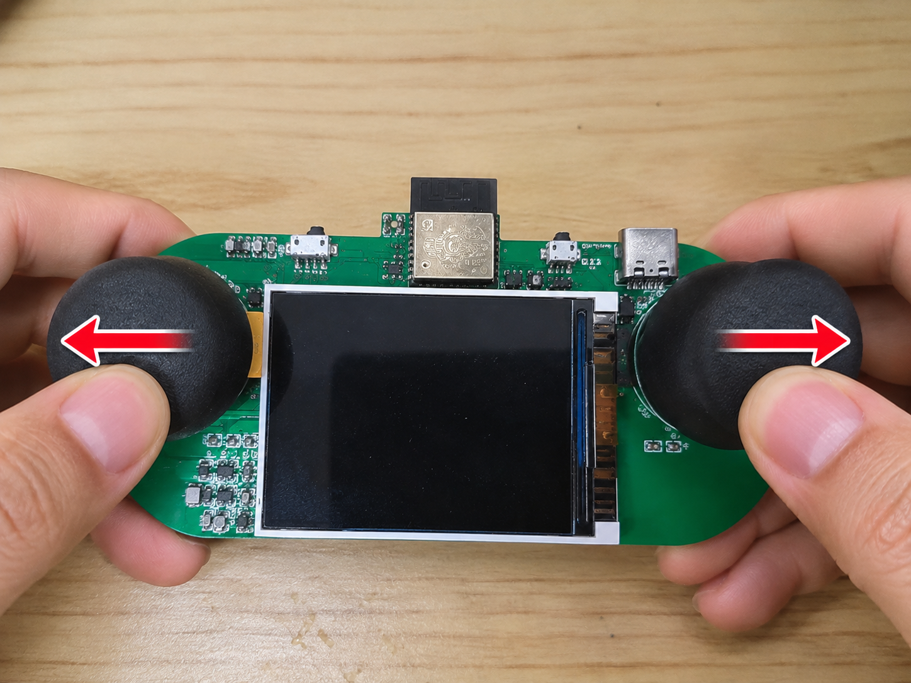

# Tiny-Drone 开源遥控器

Tiny-Drone-Controller 是 Tiny-Drone 的配套开源遥控器，基于 **ESP32-C3** 开发，支持双摇杆操控和 Wi-Fi 图传，也可以遥控 ESP-Drone。

遥控器配备 **240×320 分辨率彩色屏幕**，横屏显示时为 320×240。连接支持图传的无人机后，可以直接在屏幕上查看实时画面和飞行状态。你也可以从这个项目入手，学习摇杆采样、无线遥控和图像解码，或修改固件来适配自己的设备。

<!-- 补图说明：将图片放入对应目录，再删除图片语法外层的 HTML 注释，即可显示。 -->

<!--  -->

## 实物图

### 正面视图

<!--  -->

### PCB 与内部结构

<!--  -->

### 配合 Tiny-Drone 使用

<!--  -->

## 特点

- 双摇杆操控，分别控制油门、偏航、横滚和俯仰。
- 通过 Wi-Fi 接收兼容无人机发送的 JPEG 图像，在屏幕上实时显示。
- 自动识别 Tiny-Drone 和 ESP-Drone 热点，切换到对应的控制地址。
- 显示无人机电池电压；搭配扩展遥测固件，可显示飞行模式、相对高度和定高状态。
- 支持偏航锁定、无头模式设置、横滚与俯仰微调，以及画面 180° 旋转。
- 连接无人机热点后，可通过浏览器更新遥控器固件。
- 未连接时可进入屏幕测试，检查显示效果。

图传、遥测、无头模式和降落功能需要无人机端固件配合。ESP-Drone 的基础遥控可以使用，图传和扩展遥测则需确认具体设备是否支持。

## 注意事项

- 首次检查接线、摇杆方向和控制指令时，请拆下无人机桨叶。
- 上电时保持摇杆在正常初始位置，等待启动校准完成后再操作。
- 确认油门处于最低位置后再解锁，先检查控制方向，再进行飞行测试。
- 距离、遮挡和无线干扰都可能影响图传。画面明显延迟或断续时，请停止依赖屏幕操控，检查无线连接。
- 自动连接时建议只开启一台目标无人机，避免连接到附近其他兼容设备。
- 网页更新期间保持供电和连接稳定，并确认上传的是遥控器固件。

## 开源链接

- [遥控器固件源码](https://github.com/jonny-lekaiwu/Tiny-Drone-Controller)
- [Tiny-Drone 无人机源码](https://github.com/jonny-lekaiwu/Tiny-Drone)
- [Tiny-Drone 使用文档](https://www.lekaiwu.cn/tiny-drone/)
- 硬件工程：待补充原理图、PCB 与 BOM 链接。
- 外壳文件：待补充。

## 交流群

交流方式：待补充。

遇到问题可在 [GitHub Issues](https://github.com/jonny-lekaiwu/Tiny-Drone-Controller/issues) 反馈，并附上硬件版本、固件版本、复现步骤和串口日志，方便定位原因。

## 视频

### 遥控与图传演示

视频链接：待补充。

<!--  -->

### 焊接与组装教程

视频链接：待补充。

### 连接与操作教程

视频链接：待补充。

## 硬件设计

### 主控

主控采用 ESP32-C3，通过 Wi-Fi 连接无人机热点，发送遥控数据并接收图传及遥测数据。当前工程目标为 `esp32c3`，Flash 配置为 **4 MB**。

### 屏幕与图传

屏幕采用 ST7789 驱动，通过 SPI 接口连接主控，分辨率为 240×320，固件按 320×240 横屏显示。

无人机将 JPEG 图像分包后通过 UDP 发给遥控器。遥控器把数据拼成完整图像，解码后显示到屏幕上，并叠加状态文字。图传接收端口为 `5000`，无人机端需使用兼容的分包协议。

### 摇杆与功能按键

主控通过 ADC 读取两个摇杆的四路信号，对应油门、偏航、横滚和俯仰。固件在启动时校准摇杆，并对采样值进行滤波和死区处理。功能按键用于切换操控设置。

### 当前固件接口分配

| 功能 | 引脚或通道 | 说明 |
| --- | --- | --- |
| LCD DC | GPIO5 | 数据 / 命令选择 |
| LCD CS | GPIO6 | SPI 片选 |
| LCD MOSI | GPIO7 | SPI 数据输出 |
| LCD SCK | GPIO8 | SPI 时钟 |
| LCD RST | GPIO9 | 屏幕复位 |
| 状态 LED | GPIO10 | 低电平有效 |
| 功能按键 | GPIO20 | 内部上拉，低电平触发 |
| 偏航摇杆 | ADC1 CH2 | 油门摇杆横轴 |
| 油门摇杆 | ADC1 CH3 | 油门摇杆纵轴 |
| 横滚摇杆 | ADC1 CH1 | 方向摇杆横轴 |
| 俯仰摇杆 | ADC1 CH4 | 方向摇杆纵轴 |

接线时请对照硬件原理图，确认封装引脚、供电和外围电路。更换引脚后，也要修改 `main/app_config.h` 和 `main/app_main.c` 中的对应配置。

<!--  -->

### 电源与结构

供电方式、电池规格、充电电路和外壳尺寸：待补充，以最终发布的硬件工程为准。

## 复刻步骤

### 1. 准备元器件

按照 BOM 购买主控、ST7789 屏幕、双摇杆、功能按键、指示灯和电源器件。购买屏幕前，尤其要核对接口、引脚顺序和供电要求。

BOM 清单：待补充。

### 2. PCB 打板

根据硬件工程导出 PCB 文件并下单。板厚、尺寸和工艺参数：待补充。

<!--  -->

### 3. 焊接与组装

1. 对照原理图与贴片图完成焊接，检查器件方向和接口引脚。
2. 上电前检查电源与地之间是否短路，以及焊盘是否连锡。
3. 安装屏幕、摇杆和功能按键，检查连接及固定情况。
4. 确认供电正常后，再连接电脑烧录固件。

<!--  -->

### 4. 编译与烧录

建议使用 **ESP-IDF v5.5.3**，与当前工程配置保持一致。打开 ESP-IDF 命令行，执行：

```powershell
git clone https://github.com/jonny-lekaiwu/Tiny-Drone-Controller.git
cd Tiny-Drone-Controller
idf.py set-target esp32c3
idf.py build
idf.py -p COMX flash monitor
```

将 `COMX` 替换为实际串口，例如 `COM5`。Linux 或 macOS 用户将其替换为对应串口设备路径。串口监视器可使用 `Ctrl+]` 退出。

本仓库直接使用 `idf.py` 构建，未提供 `build.bat`。首次使用串口烧录，写入启动程序、分区表和应用固件；之后通过网页 OTA 更新时，只需上传应用固件。

构建成功后，工程根目录会自动生成 **`flash_all.bin`**，包含启动程序、分区表、初始 OTA 数据和应用固件，可从地址 `0x0` 一次烧录。合并地址和 Flash 参数来自 ESP-IDF 生成的 `build/flasher_args.json`。已有构建文件时，可运行 `combine.bat` 或 `python scripts/merge_firmware.py` 重新合并。

固件版本统一在根目录的 `version.txt` 中修改，格式为 `XX.XX.XX`。固件内嵌版本、屏幕版本和网页更新页面使用同一版本。

### 在线烧录

**[进入 Controller 一键烧录 →](https://www.lekaiwu.cn/tools/firmware/?device=tiny-drone-controller)**

使用电脑端 Chrome 或 Edge 打开页面，选择「Tiny-Drone Controller」，点击「选择 COM 口」，通过 USB 数据线连接遥控器并选择对应串口，随后自动烧录。完成后重启遥控器。

完整镜像用于首次烧录和后台发布；网页 OTA 仍使用 `build/drone_control.bin`，两者不能混用。

<!--  -->

### 5. 连接无人机

打开无人机和遥控器电源，遥控器将自动扫描名称符合以下模板的热点：

| 无人机类型 | 热点名称模板 | 默认密码 | 控制目标地址 | UDP 控制端口 |
| --- | --- | --- | --- | --- |
| Tiny-Drone | `TINY-DRONE_XXXXXXXXXXXX` | `87654321` | `192.168.26.28` | `2390` |
| ESP-Drone | `ESP-DRONE_XXXXXXXXXXXX` | `12345678` | `192.168.43.42` | `2390` |

`XXXXXXXXXXXX` 表示 12 位设备后缀。修改热点名称、密码或无人机 IP 后，需要同步调整 `main/wifi_task.c` 和 `main/wifi_task.h`。

连接成功后，屏幕会显示收到的兼容图传画面。无人机没有图传功能时，也可以使用摇杆遥控。

### 6. 摇杆与按键操作

| 控件 | 功能 |
| --- | --- |
| 油门摇杆纵轴 | 调节油门 |
| 油门摇杆横轴 | 控制偏航，受偏航锁定设置影响 |
| 方向摇杆横轴 | 控制横滚 |
| 方向摇杆纵轴 | 控制俯仰 |

摇杆的左右布局和操作方向取决于安装方式及固件映射，首次使用前请检查。

### 遥控器解锁方法

解锁前，先确认油门处于最低位置，并确保周围安全。

**同时操作左右两个摇杆：左摇杆向左拨到底，右摇杆向右拨到底，即可解锁。** 两个摇杆需要同时向外侧拨动。



> 注意：以上操作方向适用于图示遥控器及其对应固件。当前固件的解锁判断涉及两个摇杆横轴的原始值同时超过 `4000`；不同安装方式或固件映射可能导致方向不同。首次复刻测试请先拆下桨叶，检查摇杆原始值或串口日志，确认解锁方向后再安装桨叶。

同一个功能按键，在不同状态下有以下作用：

| 当前状态 | 操作 | 功能 |
| --- | --- | --- |
| 正常控制 | 单击 | 切换偏航锁定 |
| 正常控制 | 双击 | 切换降落状态，进入该状态时发送降落请求；需无人机固件支持 |
| 正常控制 | 长按 | 进入设置模式 |
| 设置模式 | 单击 | 切换无头模式设置 |
| 设置模式 | 双击 | 切换画面 0° / 180° 旋转 |
| 设置模式 | 拨动方向摇杆 | 调整横滚、俯仰微调值 |
| 设置模式 | 长按 | 保存设置并回到锁定状态 |
| 未连接 | 长按 | 进入屏幕测试 |
| 屏幕测试 | 单击 | 切换测试画面，完成一轮后退出 |

进入设置模式前，请先让无人机落地并确认电机停止。

### 7. 网页更新固件

1. 让遥控器连接到无人机热点。
2. 在正常控制状态下长按功能按键进入设置模式，查看屏幕显示的遥控器 IP，也可通过串口日志确认。
3. 将电脑或手机连接到同一无人机热点，在浏览器打开 `http://遥控器IP/`。
4. 选择编译生成的 `build/drone_control.bin`，上传并等待遥控器重启。

不要上传无人机固件、合并烧录镜像、Bootloader 或分区表文件。热点必须允许客户端之间通信；若网页无法访问，请使用串口烧录。

<!--  -->

## 故障排除

### 一直显示连接中

确认无人机已开启热点，名称长度及前缀符合模板，密码与遥控器配置一致。建议先只开启一台无人机，并查看串口日志中的扫描和连接信息。

### 已连接，但无法控制无人机

先检查遥控器是否解锁、油门映射是否正确，再核对控制目标 IP 和端口。若连接正常但无人机仍无响应，继续检查无人机端的控制协议和飞控状态。

### 能遥控，但没有图传画面

确认无人机具备摄像头并开启兼容图传，图像发送到遥控器当前 IP 的 UDP `5000` 端口。原版或其他版本 ESP-Drone 不一定支持本项目的图传协议。

### 屏幕不亮、花屏或颜色异常

检查屏幕供电、背光电路、SPI 接线及 ST7789 型号配置。未连接时长按功能按键进入屏幕测试，观察纯色与测试图案是否正常。

### 摇杆方向反了，或回中后仍有偏移

重新上电并保持摇杆在初始位置，检查 ADC 通道和方向反转配置。可在设置模式中调整横滚、俯仰微调；若原始采样值异常，应先检查接线与摇杆器件。

### 电压显示为 `---V`，或不显示高度

屏幕上的电压是无人机电池电压，需要无人机持续回传数据。显示为 `---V` 时，检查无人机端是否支持并发送电压遥测。高度、定高状态和飞行模式则需要扩展遥测固件支持。

### 网页更新失败

检查电脑或手机是否与遥控器处于同一热点，地址是否为遥控器 IP，以及固件文件是否正确。若连接中断或更新持续失败，改用串口烧录恢复。

## 项目目录

```text
Tiny-Drone-Controller/
├── main/                  # 遥控、图传、显示与摇杆逻辑
├── components/
│   ├── key_handle/        # 按键事件处理
│   ├── web_ota/           # 网页固件更新
│   └── espressif__esp_new_jpeg/  # JPEG 解码组件
├── partitions.csv         # 分区表
├── sdkconfig              # 当前工程配置
├── dependencies.lock      # 依赖版本记录
├── LICENSE                # 软件许可证
└── README.md              # 项目文档
```

## 开源协议

本项目固件采用 **GPL-3.0-only** 协议，详见 [LICENSE](https://github.com/jonny-lekaiwu/Tiny-Drone-Controller/blob/HEAD/LICENSE)。第三方组件保留各自的版权声明与许可证，使用和分发时请同时遵守对应条款。

硬件工程及外壳文件的许可方式，以其发布页面的说明为准。
